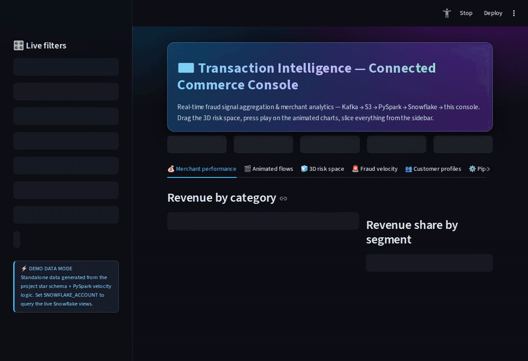

# Connected Commerce Transaction Intelligence Pipeline

Real-time fraud signal aggregation and merchant analytics — Kafka → S3 → PySpark → Snowflake → Streamlit



## Overview

This project simulates a production-grade payment data platform modeled
after the architecture used by large-scale Connected Commerce teams. It
demonstrates the full data engineering lifecycle — from synthetic
transaction event generation through Kafka, to curated Parquet/Iceberg
tables on S3, to an analytical star schema in Snowflake, surfaced through
a real-time Streamlit dashboard.

**Core focus areas:** Kafka + S3 integration, PySpark batch processing,
Kimball dimensional modeling in Snowflake, data quality enforcement,
CI/CD with GitHub Actions.

## The console

The serving layer is an interactive transaction intelligence console:

- **Live sidebar filters** — date range, merchant categories, segments,
  channels, risk tiers, states, a minimum-amount threshold and a
  fraud-flagged-only toggle; every chart, table and KPI re-renders
  instantly.
- **KPI cards with deltas** — filtered revenue and transaction volume
  vs. the prior equal-length period, average ticket, high-severity
  alert count and high-risk share.
- **Animated charts** — Plotly `animation_frame` views: daily revenue
  by category and a cumulative revenue race you can play, plus an
  animated fraud-velocity scatter through time.
- **3D risk space** — a rotatable `Scatter3d` of every transaction in
  txn-count (1h) × spend-velocity (24h) × amount space — the exact
  velocity features computed by the PySpark enrichment job — and a
  category × date **revenue surface terrain** (drag to orbit, scroll
  to zoom).
- **Fraud velocity monitor** — alert-score distribution, a
  category × risk-tier signal heatmap, the velocity scatter and a live
  alert feed, all driven by the same flags as
  `fraud_velocity_alerts_v` (high velocity, cross-merchant,
  international, high risk tier).
- **Merchant, customer & pipeline views** — revenue by category and
  segment, daily trends, top-20 merchants, RFM-style customer spend
  profiles, and pipeline health with stage status for every hop from
  Kafka producer to this dashboard.
- **Dark UI** — gradient hero header, glass KPI cards and a custom
  dark theme (`.streamlit/config.toml` + inline CSS).
- **Runs standalone** — with no Snowflake credentials configured, the
  console serves demo data generated from the project's own star
  schema and PySpark velocity logic (`dashboard/demo_data.py`):
  risk tiers at the `enrich.py` thresholds ($1k / $5k spend velocity),
  `high_velocity_flag` at 10+ transactions in an hour,
  `cross_merchant_flag` at 5+ distinct merchants in an hour, and
  customer spend segments at the view's lifetime thresholds. Set
  `SNOWFLAKE_ACCOUNT` / `SNOWFLAKE_USER` / `SNOWFLAKE_PASSWORD` and the
  same console queries the live Snowflake views instead.

## Architecture

```
Kafka Producer → Kafka Topic → S3 Raw (AVRO) → PySpark Validate →
PySpark Enrich → S3 Curated (Iceberg) → Snowflake Star Schema → Streamlit
```

**Data model — Kimball star schema**

- `fact_transactions` — amount, velocity measures
  (`txn_count_last_1h`, `distinct_merchants_1h`, `spend_velocity_24h`),
  channel, event time; clustered on `(ingest_date, merchant_key)`.
- `dim_merchant` — merchant, category, segment (everyday spend,
  discretionary, travel, healthcare & wellness, recurring, cash access),
  city/state.
- `dim_customer` — customer, account type, risk tier.
- `dim_fraud_signal` — conformed flag combinations: cross-merchant,
  international, high-velocity, risk tier, signal label.
- `dim_date` — calendar spine, 2020–2030.

Analytical views: `merchant_daily_performance_v` (daily revenue, rolling
7d revenue, day-over-day delta), `fraud_velocity_alerts_v` (one row per
flagged transaction with alert severity), `customer_spend_profile_v`
(lifetime spend, recency/frequency, platinum/gold/silver/bronze segment).

## Key engineering decisions

**Why AVRO for raw, Parquet/Iceberg for curated?** AVRO is
schema-enforced and compact for high-throughput Kafka streaming;
Parquet with Iceberg gives columnar compression, time-travel, and
schema evolution for batch analytics — aligning with how production
lakehouse pipelines are structured.

**Why Kimball star schema in Snowflake?** Analytics teams query for
business-level aggregations (merchant performance, customer spend
trends). A denormalized star schema minimizes join complexity and plays
to Snowflake's columnar execution engine.

**Velocity features in PySpark — not SQL.** Computing
`txn_count_last_1h` and `spend_velocity_24h` as window functions at the
PySpark layer (before load) keeps Snowflake serving analytical reads
only. The PySpark job uses
`Window.partitionBy("customer_id").orderBy("event_time").rangeBetween(-3600, 0)`.

**Micro-batch vs. batch.** The Kafka consumer runs as a micro-batch
(5-minute flush to S3), while the PySpark enrichment job runs as a
scheduled hourly batch via `run_pipeline.sh`.

## Tech stack

Python 3.11+ · Kafka · PySpark · Snowflake · Apache Iceberg · AVRO ·
Parquet · Streamlit · Plotly · pandas · Great Expectations ·
GitHub Actions · Docker

## Repository structure

```
transaction-intelligence-pipeline/
├── dashboard/
│   ├── app.py                  # Streamlit + Plotly console
│   ├── demo_data.py            # standalone data from the project schemas
│   └── snowflake_connector.py  # Snowflake views / demo-mode data access
├── ingestion/
│   └── producer.py             # Kafka transaction event producer
├── processing/
│   ├── jobs/                   # validate, enrich (velocity features), Iceberg write
│   └── utils/                  # Spark session helpers
├── warehouse/
│   ├── ddl/                    # star schema: fact + dimensions
│   ├── load/                   # COPY INTO
│   └── views/                  # merchant / fraud / customer analytical views
├── tests/                      # enrichment + validation tests
├── .streamlit/config.toml      # dark console theme
└── requirements.txt
```

## Setup & run

**Standalone console (no credentials needed)**

```bash
pip install -r requirements.txt
streamlit run dashboard/app.py
```

**Full pipeline**

Prerequisites: Docker + Docker Compose, Python 3.11+, AWS credentials
configured (`~/.aws/credentials`), a Snowflake account + warehouse.

```bash
docker-compose up -d                 # 1. start Kafka locally
bash scripts/setup_kafka.sh
pip install -r requirements.txt      # 2. install dependencies
bash scripts/setup_snowflake.sh      # 3. bootstrap Snowflake objects
bash scripts/run_pipeline.sh         # 4. producer → consumer → PySpark
                                     #    validate → enrich → Iceberg → COPY INTO
streamlit run dashboard/app.py       # 5. launch dashboard (live Snowflake mode
                                     #    when SNOWFLAKE_ACCOUNT is set)
```

### Testing

```bash
pytest tests/ -v --tb=short
```

Tests cover: AVRO schema enforcement, PySpark schema validation logic,
velocity feature computation correctness, S3 path partitioning,
Snowflake DDL idempotency.

## CI/CD

GitHub Actions runs on every push to main and every pull request:
flake8 linting, the pytest suite, and a schema compatibility check
against an AVRO registry mock. Great Expectations checkpoints gate the
Silver/curated loads (schema violations, quarantine rate, DLQ counts —
the same signals surfaced on the console's Pipeline health tab).

## Sample queries (Snowflake)

**Top 10 merchants by revenue — last 30 days**

```sql
SELECT
    dm.merchant_name,
    dm.merchant_category,
    SUM(ft.amount_usd)        AS total_revenue,
    COUNT(ft.transaction_id)  AS txn_count
FROM fact_transactions ft
JOIN dim_merchant dm ON ft.merchant_key = dm.merchant_key
JOIN dim_date dd     ON ft.date_key     = dd.date_key
WHERE dd.full_date >= DATEADD('day', -30, CURRENT_DATE)
GROUP BY 1, 2
ORDER BY total_revenue DESC
LIMIT 10;
```

**High-velocity fraud signal detection**

```sql
SELECT
    dc.customer_id,
    ft.txn_count_last_1h,
    ft.spend_velocity_24h,
    ft.cross_merchant_flag,
    COUNT(*) AS alert_count
FROM fact_transactions ft
JOIN dim_customer dc ON ft.customer_key = dc.customer_key
WHERE ft.txn_count_last_1h > 10
   OR ft.cross_merchant_flag = TRUE
   OR ft.spend_velocity_24h > 5000
GROUP BY 1, 2, 3, 4
ORDER BY alert_count DESC;
```

## Skills demonstrated

- **Kafka + S3 integration** — AVRO-serialized event streaming with micro-batch S3 landing
- **PySpark advanced** — window functions for velocity feature engineering, schema enforcement, Iceberg writes
- **Snowflake** — star schema DDL, external stage, COPY INTO, analytical views
- **Data serialization** — AVRO (ingestion), Parquet + Iceberg (curated layer)
- **Processing methodologies** — micro-batch (Kafka consumer) + batch (PySpark hourly job)
- **Data modeling** — Kimball star schema with surrogate keys and SCD-ready dimensions
- **Data quality** — Great Expectations checkpoint suite
- **CI/CD** — GitHub Actions lint + test pipeline
- **Unix scripting** — shell orchestration for end-to-end pipeline execution
